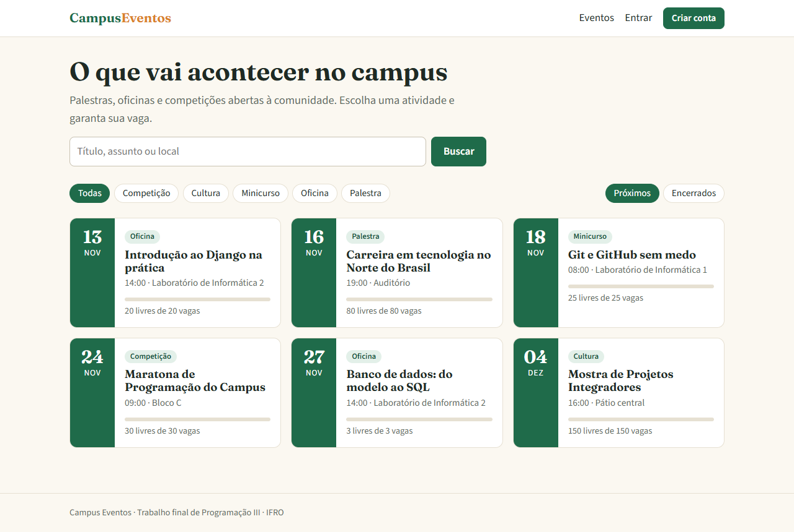
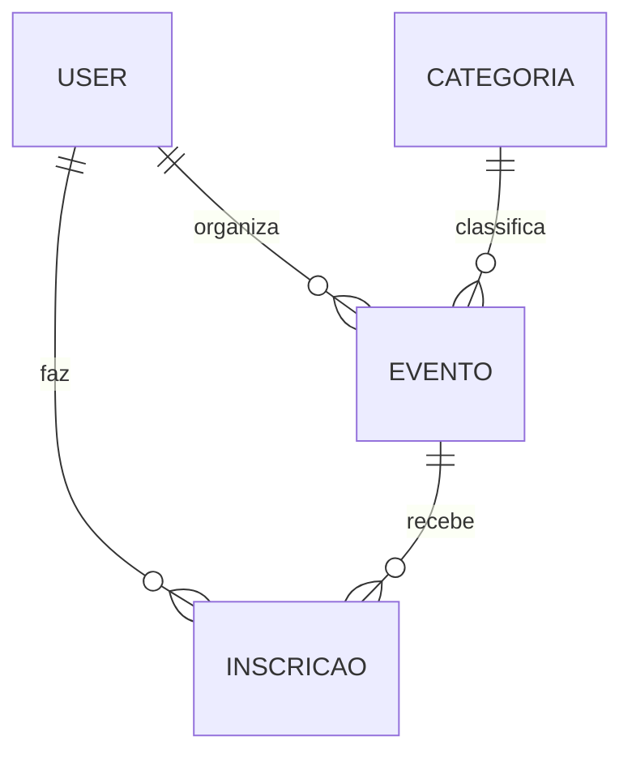

# Campus Eventos

Sistema web em Django para divulgar eventos acadêmicos e gerenciar inscrições. Qualquer pessoa consulta os eventos; quem tem conta publica eventos e se inscreve nos eventos de outras pessoas, respeitando o limite de vagas.



## Vídeo explicativo

**Link do vídeo:** [PREENCHER]

## Sistema Hospedado

**Link do PythonAnywhere:** brenofa.pythonanywhere.com

## Informações acadêmicas

| | |
|---|---|
| **Instituição** | IFRO Campus Ariquemes |
| **Curso** | Análise e Desenvolvimento de Sistemas (ADS), 4º período |
| **Disciplina** | Programação III |
| **Professor** | Marcos Faino |

## Equipe

| Integrante | Matrícula |
|---|---|
| Igor Malher | 2025105100022 |
| Breno Ferreira | 2025105100004 |
| Paulo Marrane | 2025105100015 |

## Funcionalidades

- Cadastro livre de usuários, login e logout
- Publicação, edição e exclusão de eventos, restritas a quem organiza o evento
- Inscrição e cancelamento, com limite de vagas e proteção contra inscrição duplicada
- Busca por texto, filtro por categoria, eventos próximos ou encerrados, e paginação
- Lista de inscritos visível apenas para quem organiza o evento
- Painel administrativo com filtros, busca e inscrições dentro da página do evento

## Como cada requisito foi atendido

| Requisito | Onde está |
|---|---|
| Três tabelas relacionadas por `ForeignKey`, incluindo `auth.User` | [eventos/models.py](eventos/models.py): `Categoria`, `Evento` e `Inscricao`, com `organizador` e `participante` apontando para o usuário |
| Models registrados no admin | [eventos/admin.py](eventos/admin.py) |
| Views e rotas | [eventos/views.py](eventos/views.py), [eventos/urls.py](eventos/urls.py), [contas/urls.py](contas/urls.py) |
| Herança de templates | [templates/base.html](templates/base.html), estendido pelas demais páginas |
| Cadastro de usuários | [contas/forms.py](contas/forms.py), [contas/views.py](contas/views.py) |
| Controle de acesso | `LoginRequiredMixin` e `OrganizadorRequiredMixin` em [eventos/views.py](eventos/views.py) |
| Deploy no PythonAnywhere | [docs/DEPLOY_PYTHONANYWHERE.md](docs/DEPLOY_PYTHONANYWHERE.md) |
| Roteiro de dificuldades | [docs/LOG_DE_DIFICULDADES.md](docs/LOG_DE_DIFICULDADES.md) |

## Modelo de dados



`Inscricao` liga o usuário ao evento e tem uma restrição de unicidade no banco: a mesma pessoa não se inscreve duas vezes no mesmo evento.

## Quem pode fazer o quê

| Ação | Visitante | Usuário logado | Organizador do evento |
|---|:---:|:---:|:---:|
| Ver eventos | Sim | Sim | Sim |
| Publicar evento | Não | Sim | Sim |
| Inscrever-se | Não | Sim | Não |
| Editar ou excluir o evento | Não | Não | Sim |
| Ver a lista de inscritos | Não | Não | Sim |

## Como rodar localmente

É preciso ter Python 3.10 ou mais recente e o Git.

### 1. Clonar o repositório

```bash
git clone https://github.com/BrenoFA/CuiudosSystem.git
cd CuiudosSystem
```

### 2. Criar e ativar o ambiente virtual

Windows (PowerShell):

```powershell
python -m venv .venv
.\.venv\Scripts\Activate.ps1
```

Se o PowerShell bloquear a ativação, execute `Set-ExecutionPolicy -Scope Process RemoteSigned` e tente de novo.

Linux ou macOS:

```bash
python3 -m venv .venv
source .venv/bin/activate
```

### 3. Instalar as dependências

```bash
python -m pip install -r requirements.txt
```

### 4. Criar o arquivo de configuração

Windows (PowerShell):

```powershell
Copy-Item .env.example .env
```

Linux ou macOS:

```bash
cp .env.example .env
```

### 5. Preparar o banco de dados

```bash
python manage.py migrate
python manage.py popular_dados
python manage.py createsuperuser
```

O comando `popular_dados` cria categorias e eventos de exemplo e pode ser executado mais de uma vez sem duplicar nada. O `createsuperuser` cria a conta usada no painel administrativo.

### 6. Executar

```bash
python manage.py runserver
```

- Site: <http://127.0.0.1:8000/>
- Administração: <http://127.0.0.1:8000/admin/>

## Testes

```bash
python manage.py test
```

São 41 testes automatizados, que cobrem o controle de acesso, o cadastro, as regras de inscrição, as listagens e o painel administrativo.

## Estrutura do projeto

```text
CuiudosSystem/
├── config/              Configurações, rotas principais e WSGI
├── contas/              Cadastro, login e logout
├── eventos/             Models, views, formulários, admin e testes
│   └── management/      Comando popular_dados
├── templates/
│   ├── base.html        Layout herdado pelas páginas
│   ├── partials/        Menu, mensagens, campos e paginação
│   ├── contas/          Login e cadastro
│   └── eventos/         Páginas de eventos
├── static/              CSS e ícone
├── docs/                Guias de deploy e GitHub, e log de dificuldades
├── .env.example         Modelo das variáveis de ambiente
├── manage.py
└── requirements.txt
```

## Tecnologias

- Python e Django 5.2 LTS
- SQLite
- HTML e CSS próprios, sem framework de CSS
- python-dotenv para as variáveis de ambiente
- PythonAnywhere para a hospedagem
